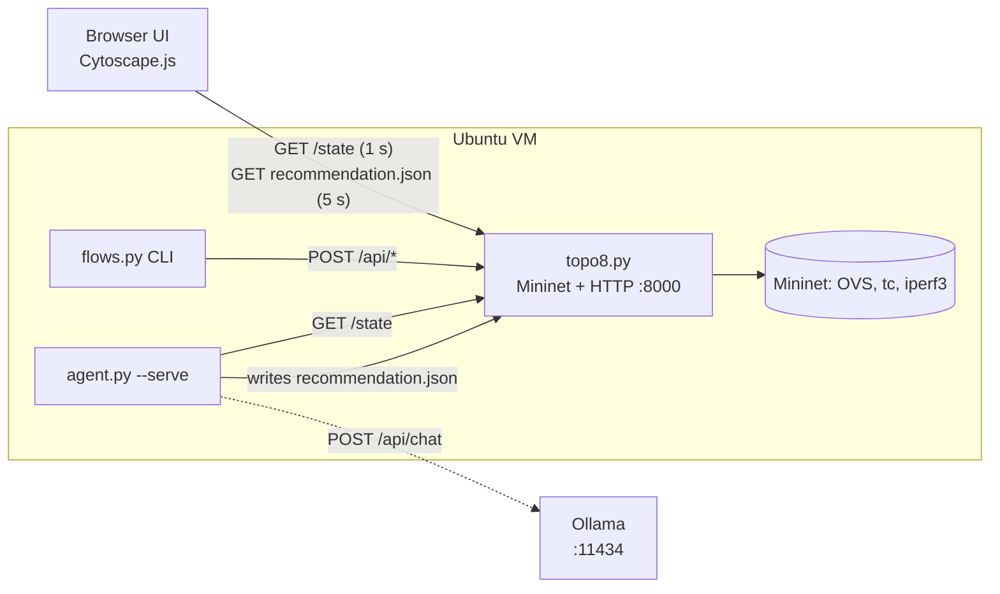

# AI Network Observer

**A live congestion view for an emulated network, with autonomous traffic-diversion recommendations from rules and a local LLM.**


-orange)


> POC #1 in a series of hands-on systems-meets-AI proof-of-concepts. Follow [@<your-github-handle>](https://github.com/<your-github-handle>) for the next ones.

## What it does

- Builds an 8-switch, 10-host network in [Mininet](http://mininet.org) (two core, two distribution, four access switches) and lets you generate TCP/UDP traffic on it.
- Shows every link's utilization, queue depth and status on a read-only web dashboard, with the active flow paths highlighted on the graph.
- Watches the network and recommends which flow to move to the other core switch, with the exact command, every 5 seconds.
- Optionally asks a small local LLM (via [Ollama](https://ollama.com)) to explain the recommendation in plain English. No cloud API and no API key.

## How the "AI" works

The detection and the move scoring are deterministic code. The local LLM only writes a short explanation of a recommendation the code already made, so a slow or wrong LLM never changes the recommendation. Use `--no-llm` to switch it off.

- **Congestion rule:** a switch link is congested when, over a 10-second window, utilization stays at or above 80%, the queue stays at or above 20 packets, or packet drops increase.
- **Move scoring:** for every flow on a congested link, the agent estimates offered load divided by link capacity before and after moving the flow to the other core, and recommends the move that cuts the worst overload the most (at least 10%). If no move helps, it says so.
- **Human in the loop:** it only recommends. You run the printed command.

## Architecture



More detailed diagrams: [`docs/`](docs/).

## Quickstart

Tested on Ubuntu 22.04 (a VM is fine). Needs root for Mininet.

```bash
git clone https://github.com/<your-github-handle>/ai-network-observer.git
cd ai-network-observer
./setup.sh                    # apt packages, Cytoscape.js, dashboard layout
sudo python3 topo8.py         # terminal 1: testbed + dashboard on :8000
python3 agent.py --serve      # terminal 2: recommendations (add --no-llm to skip the model)
```

Open <http://localhost:8000>. If Mininet runs in a VirtualBox VM, add a NAT port-forward rule from host port 8000 to guest port 8000.

### Try it: create congestion

```bash
python3 flows.py h1,h6,udp,1,900s h4,h7,udp,1,900s h2,h8,udp,1,900s h5,h9,udp,1,900s
```

Four 1 Mbps UDP flows all start through core switch `s1` and offer about 4 Mbps to 3 Mbps links. The `s3-s1` and `s4-s1` links turn red, and the **Autonomous Recommendations** panel proposes a move such as:

```bash
python3 flows.py --steer h1,h6,s2
```

Run it and watch the load shift to `s2`. After a second move the flows are split across both cores and the congestion clears. Stop everything with `python3 flows.py --stop`.

### Optional: local LLM explanations

```bash
ollama pull qwen2.5:1.5b
export OLLAMA_URL=http://localhost:11434      # default: http://10.0.2.2:11434 (VirtualBox NAT host)
export OLLAMA_MODEL=qwen2.5:1.5b              # default
python3 agent.py --serve
```

## Command-line reference

`flows.py` talks to the testbed's REST API.

| Command | What it does |
|---|---|
| `python3 flows.py h1,h10,udp,15,600s` | Start a flow: `src,dst,proto,mbps,duration[,core]` (duration `600`, `600s`, `10m`, `1h`; `mbps` 0 = unlimited for TCP) |
| `python3 flows.py --steer h1,h10,s2` | Move a host pair's traffic through core `s1` or `s2` |
| `python3 flows.py --link s3-s1,down` | Bring a link down or up |
| `python3 flows.py --stop` | Stop all flows and remove steering rules |

## REST API (port 8000)

| Endpoint | Method | Purpose |
|---|---|---|
| `/state` | GET | Live utilization, queues, down links, running flows with paths, link capacities |
| `/recommendation.json` | GET | Latest agent recommendation (written by `agent.py --serve`) |
| `/api/iperf` | POST | `{src,dst,secs,proto,mbps,core}` start a flow |
| `/api/steer` | POST | `{src,dst,core}` per-pair path override |
| `/api/link` | POST | `{id,status}` link up or down |
| `/api/divert` | POST | `{core}` change the default core |
| `/api/stop` | POST | Stop all flows |

## Under the hood

- **Mininet 2.3.0** builds the network: `Mininet(controller=None, switch=OVSSwitch, link=TCLink)`, `addLink(bw=...)` for shaped links, `net[h].popen(...)` to run iperf3 in host namespaces.
- **Open vSwitch 2.17.12** forwards with static flow rules loaded by `ovs-ofctl replace-flows` (priority 100 by destination MAC, priority 40000 per-pair overrides). There is no controller.
- **Metrics** come from `/sys/class/net/*/statistics` (utilization, once a second) and `tc -s class show` (queue depth, every 2 seconds).
- **Dashboard:** Cytoscape.js 3.30.2, polling `/state` every second.

## Tested environment

| Component | Version |
|---|---|
| Ubuntu (VM) | 22.04.5 LTS, Python 3.10.12 |
| Mininet | 2.3.0 |
| Open vSwitch | 2.17.12 |
| iperf3 | 3.9 |
| Ollama (optional) | 0.40.16, `qwen2.5:1.5b` |
| VirtualBox / WSL2 | 7.2.22 / 2.7.3.0 |

Runs on a laptop with 8 GB RAM and 4 cores: the VM gets 2 GB and 2 vCPUs, and Ollama runs CPU-only in WSL2. LLM explanations can take minutes on that hardware, while recommendations appear immediately.

## Limitations

- Routing is simple on purpose: one core switch carries traffic, and the other is the alternate. Moves are per host pair.
- Move estimates are rough. TCP adapts its rate, so real results can differ.
- No VLANs yet, so VLAN activity is not monitored.
- The REST API has no authentication and the testbed runs as root. Use it on a lab machine only.
- This is a simulation. Nothing here talks to real switches yet.

## Roadmap

- [ ] VLAN support and broadcast-storm / MAC-flap detection
- [ ] Anomaly detection (Isolation Forest) and short-horizon utilization forecasting
- [ ] Optional auto-apply with dry-run and rollback
- [ ] Larger and configurable topologies
- [ ] Real telemetry sources (SNMP, sFlow, gNMI)

## Project layout

```
topo_def.py        shared topology definition
topo8.py           Mininet testbed + HTTP API
agent.py           congestion analysis and recommendations
flows.py           command-line client
setup.sh           dependency setup
ui/                dashboard (index.html, gen_topology.py)
docs/              diagrams and demo
```

## Contributing

Issues and pull requests are welcome. Good first issues: VLAN support, a scenario file format for flows, and a second topology.

## License

MIT, see [LICENSE](LICENSE).
